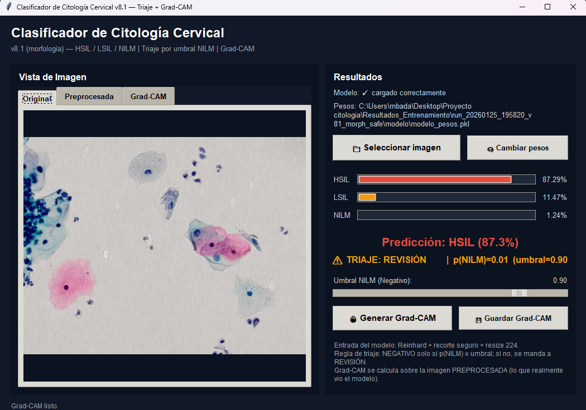
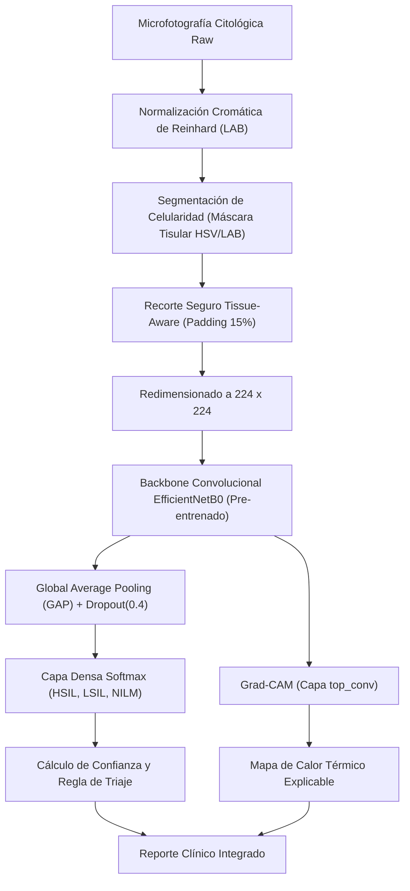

<div align="center">

# Automated Detection of Cervical Intraepithelial Lesions using EfficientNetB0 & Explainable AI (XAI)
### Sistema de Detección Automatizada de Lesiones Intraepiteliales Cervicales bajo el Sistema Bethesda

[](https://www.python.org/)
[](https://tensorflow.org/)
[-059669.svg)](#sistema-de-clasificación-bethesda)
[](#explicabilidad-clínica-xai-con-grad-cam)
[](LICENSE)
[](https://www.upchiapas.edu.mx/)

<p align="center">
  <b>Una herramienta de soporte clínico (CAD) asistida por aprendizaje profundo para el tamizaje oportuno de cáncer cervicouterino, optimizada para entornos de bajos recursos computacionales.</b>
</p>

</div>

---

## 📌 Resumen del Proyecto / Project Overview

El **cáncer cervicouterino (CaCu)** continúa siendo uno de los desafíos de salud pública más severos en regiones vulnerables, evidenciando altas tasas de morbimortalidad femenina. A pesar de que la citología convencional (Papanicolaou) es el estándar masivo de tamizaje, su sensibilidad es variable debido a la fatiga visual del citotécnico y la subjetividad en la interpretación celular, lo que genera falsos negativos perjudiciales para la salud del paciente.

Este repositorio contiene la implementación completa del sistema desarrollado en la investigación:  
> **"Detección Automatizada de Lesiones Intraepiteliales Cervicales mediante el Algoritmo EfficientNetB0 y Técnicas de Inteligencia Artificial Explicable (XAI)"**  
> *Congreso Internacional de Investigación en Mecatrónica, Computación y Tecnologías de la Información (CIMCYT 2026).*

### 🌟 Aspectos Destacados
- **Pipeline Integral de Preprocesamiento:** Normalización cromática de Reinhard en espacio CIELAB y recorte tisular *tissue-aware* adaptativo para aislar conglomerados celulares relevantes sin artefactos de fondo.
- **Backbone Ligero y Eficiente:** Arquitectura convolucional **EfficientNetB0** (4.3M parámetros, ~29 MB de peso), diseñada para viabilidad en hardware clínico de punto de atención (*Point-of-Care / Edge Computing*).
- **Enfoque de Triaje Asimétrico:** Ponderación diferenciada en la función de pérdida (`HSIL: 2.0`, `LSIL: 1.2`, `NILM: 0.8`), priorizando una **sensibilidad diagnóstica del 92% en HSIL** y una **exactitud global del 94%**.
- **Inteligencia Artificial Explicable (XAI):** Mapeo de activación con **Grad-CAM** (*Gradient-weighted Class Activation Mapping*), ofreciendo a los especialistas mapas de calor que transparentan la toma de decisiones y confirman la coherencia morfológica nuclear.
- **Interfaz Gráfica de Soporte Clínico (GUI):** Entorno de escritorio interactivo en Tkinter para carga de imágenes, ajuste dinámico de umbrales clínicos y exportación de reportes diagnósticos.

---

## 🖥️ Interfaz Gráfica de Usuario (Clinical CAD GUI)

El sistema incluye una interfaz diseñada bajo estándares ergonómicos para citopatología digital, permitiendo al especialista auditar la imagen en tres etapas: **Original**, **Preprocesada** y **Grad-CAM superpuesto**.

<div align="center">
  
  <p><i>Figura 1: Entorno de escritorio del sistema de soporte clínico mostrando la predicción diagnóstica, distribución de probabilidades Bethesda, umbral interactivo de triaje y mapa de calor Grad-CAM.</i></p>
</div>

### Componentes de la Interfaz:
1. **Visor Multimodal con Pestañas:**
   - **Original:** Visualización directa de la microfotografía capturada.
   - **Preprocesada:** Muestra el resultado tras la normalización Reinhard y el recorte seguro centrado en la masa celular.
   - **Grad-CAM:** Mapa de calor con mapa de color *JET* superpuesto, resaltando las aberraciones nucleares o la relación núcleo-citoplasma.
2. **Triaje Clínico con Umbral Dinámico:**
   - Permite ajustar el umbral de negatividad para **NILM** (por defecto $p \ge 0.90$).
   - Si la probabilidad de NILM es inferior al umbral, el sistema alerta automáticamente **⚠️ TRIAJE: REMISIÓN A COLPOSCOPIA / REVISIÓN**, mitigando el riesgo de falsos negativos.
3. **Módulo de Pesos y Exportación:**
   - Posibilidad de alternar pesos entrenados (`.pkl`) y exportar el mapa explicativo con un solo clic.

---

## 🔬 Flujo Metodológico y Arquitectura



Para una descripción detallada del diagrama de flujo completo, consulte [assets/d_flujo.png](assets/d_flujo.png) y el documento [docs/paper_summary.md](docs/paper_summary.md).

---

## 📊 Estudio Comparativo de Arquitecturas (Benchmarking)

Evaluación comparativa reportada en el artículo frente a arquitecturas convencionales sobre un conjunto de prueba independiente (*SIPaKMeD* + *Mendeley LBC*):

| Arquitectura Base | Exactitud Global (Accuracy) | Sensibilidad (HSIL) | Tamaño del Modelo | Viabilidad en Dispositivos Médicos Edge |
| :--- | :---: | :---: | :---: | :---: |
| **VGG16** | 81.0% | 77.0% | ~528 MB | ❌ Inviable por consumo de memoria |
| **ResNet50** | 89.0% | 86.0% | ~98 MB | ⚠️ Moderada |
| **EfficientNetB0 (Propuesto)** | **94.0%** | **92.0%** | **~29 MB** | **✅ Óptima (Bajo consumo y alta velocidad)** |

> **Nota Clínica:** El modelo prioriza la sensibilidad en **HSIL** debido a que un falso negativo en una lesión de alto grado pone en riesgo inminente a la paciente. Los errores remanentes se concentran en la frontera morfológica entre LSIL y HSIL, solapamiento biológicamente natural que en ambos casos deriva en una canalización segura a colposcopia.

---

## 📁 Estructura del Repositorio

```text
cervical-cells-deep-learning/
├── assets/
│   ├── interfaz.png             # Captura de pantalla de la GUI clínica
│   └── d_flujo.png              # Diagrama de flujo metodológico de alta resolución
├── data/
│   └── README.md                # Guía de descarga y organización de datasets (SIPaKMeD/Mendeley)
├── docs/
│   ├── paper_summary.md         # Resumen extendido del artículo CIMCYT 2026
│   └── pipeline_architecture.md # Especificación técnica del algoritmo
├── models/
│   └── .gitkeep                 # Carpeta para almacenar pesos entrenados (.pkl / .h5)
├── scripts/
│   ├── entrenamiento_v8_1.py    # Script de investigación original de entrenamiento
│   └── interfaz_v8_1.py         # Script de investigación original de la GUI
├── src/
│   ├── __init__.py
│   ├── config.py                # Hiperparámetros, umbrales y constantes del sistema
│   ├── dataset.py               # Generación de particiones train/val/test estratificadas
│   ├── preprocessing.py         # Normalización Reinhard, recorte tisular y augmentations
│   ├── model.py                 # Definición de EfficientNetB0, Grad-CAM y serialización
│   ├── train.py                 # Pipeline de entrenamiento en 2 fases con métricas
│   └── gui.py                   # Aplicación de escritorio Tkinter con visualización XAI
├── .gitignore                   # Exclusión de archivos binarios pesados y temporales
├── app.py                       # Punto de entrada directo para lanzar la GUI
├── train.py                     # Punto de entrada directo para entrenar el modelo
├── requirements.txt             # Dependencias del entorno en pip
├── environment.yml              # Entorno Conda reproducible
├── LICENSE                      # Licencia MIT de código abierto
├── CITATION.cff                 # Archivo estándar de citación académica
└── README.md                    # Documentación principal
```

---

## 🚀 Instalación y Puesta en Marcha

### 1. Clonar el Repositorio
```bash
git clone https://github.com/cribnez/cervical-cells-deep-learning.git
cd cervical-cells-deep-learning
```

### 2. Crear y Activar un Entorno Virtual

**Opción A: Con Conda (Recomendado)**
```bash
conda env create -f environment.yml
conda activate cervical-cad
```

**Opción B: Con Python venv y pip**
```bash
python -m venv venv
# En Windows:
venv\Scripts\activate
# En Linux / macOS:
source venv/bin/activate

pip install -r requirements.txt
```

---

## 💻 Guía de Uso

### 1. Ejecutar la Interfaz Gráfica (CAD GUI)
Para iniciar la aplicación de escritorio y analizar imágenes interactivamente:
```bash
python app.py
```
* **Paso 1:** Pulse **"📁 Cargar Imagen"** y seleccione una microfotografía (`.png`, `.jpg`, `.bmp`, `.tif`).
* **Paso 2:** Si cuenta con un archivo de pesos entrenados generado en el entrenamiento, selecciónelo con **"🧠 Cargar Pesos (.pkl)"** (por defecto busca en `models/modelo_pesos.pkl`).
* **Paso 3:** Observe la predicción, la distribución porcentual y la sugerencia de triaje clínico.
* **Paso 4:** Haga clic en **"🔥 Generar Grad-CAM"** para proyectar el mapa de calor explicativo en la pestaña correspondiente.
* **Paso 5:** Guarde el resultado con **"💾 Exportar Mapa"**.

---

### 2. Entrenar el Modelo (Pipeline en 2 Fases)

Organice las imágenes dentro de `data/` con las carpetas de clase `HSIL/`, `LSIL/` y `NILM/` (consulte [data/README.md](data/README.md)):

```bash
python train.py --data_dir data/ --epochs_fase1 20 --epochs_fase2 20 --batch_size 32
```

**Parámetros configurables:**
- `--data_dir`: Ruta a la carpeta que contiene las carpetas por clase.
- `--results_dir`: Directorio donde se guardarán los resultados, pesos y gráficos (por defecto `results/`).
- `--epochs_fase1`: Épocas para entrenar la cabeza de clasificación con el extractor congelado.
- `--epochs_fase2`: Épocas de ajuste fino (*fine-tuning*) de las últimas capas convolucionales.
- `--lr_inicial`: Tasa de aprendizaje inicial (por defecto `1e-3`).
- `--lr_fine`: Tasa de aprendizaje para ajuste fino (por defecto `3e-5`).
- `--skip_split`: Si el dataset ya cuenta con subcarpetas `train/`, `val/`, `test/`.

Al finalizar la ejecución, se generarán automáticamente:
- `modelo/modelo_pesos.pkl` (pesos serializados en pickle para la interfaz).
- `modelo/best_weights.weights.h5` (pesos con menor pérdida en validación).
- `graficos/matriz_confusion_normalizada.png` y `graficos/curvas_entrenamiento.png`.
- `metricas/resultados.json` con accuracy, sensibilidad, especificidad y F1 por clase.

---

## 📚 Citación Científica / Citation

Si este código, modelo o metodología le resulta de utilidad en su investigación, por favor cite el artículo:

```bibtex
@inproceedings{ibanez2026cervical,
  title     = {Detecci{\'o}n Automatizada de Lesiones Intraepiteliales Cervicales mediante el Algoritmo EfficientNetB0 y T{\'e}cnicas de Inteligencia Artificial Explicable (XAI)},
  author    = {G{\'o}mez L{\'o}pez, Ximena Itzel and Somohano Maldonado, Axel Daniel and Cueto Aguilar, Omar Alexis and Hern{\'a}ndez Santiz, Georgina and Pedrero De La Cruz, Oscar Jose Maria and Ib{\'a}{\~n}ez Nang{\"u}el{\'u}, Christian Roberto},
  booktitle = {Memorias del Congreso Internacional de Investigaci{\'o}n en Mecatr{\'o}nica, Computaci{\'o}n y Tecnolog{\'i}as de la Informaci{\'o}n (CIMCYT 2026)},
  year      = {2026},
  publisher = {Universidad Polit{\'e}cnica de Chiapas},
  address   = {Suchiapa, Chiapas, M{\'e}xico}
}
```

---

## 👥 Autores y Agradecimientos

- **Ximena Itzel Gómez López** — Universidad Politécnica de Chiapas
- **Axel Daniel Somohano Maldonado** — Universidad Politécnica de Chiapas
- **Omar Alexis Cueto Aguilar** — Universidad Politécnica de Chiapas
- **Georgina Hernández Santiz** — Universidad Politécnica de Chiapas
- **Oscar Jose Maria Pedrero De La Cruz** — Universidad Politécnica de Chiapas
- **Christian Roberto Ibáñez Nangüelú** *(Investigador Responsable / Correspondencia: `cribn@ib.upchiapas.edu.mx`)*

Los autores agradecen al **Grupo de Investigación en Dispositivos Biomédicos Inteligentes** y a la **Universidad Politécnica de Chiapas** por el respaldo técnico y de infraestructura, así como al **Tecnológico Nacional de México** por el financiamiento a través de la convocatoria PRODEP 2023.

---

## 📄 Licencia

Este proyecto se distribuye bajo la licencia **MIT**. Consulte el archivo [LICENSE](LICENSE) para más detalles.
