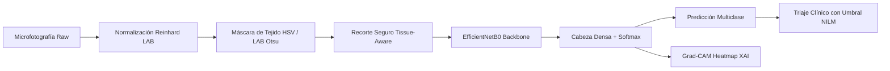

# Resumen Científico del Proyecto (CIMCYT 2026)

**Título:** Detección Automatizada de Lesiones Intraepiteliales Cervicales mediante el Algoritmo EfficientNetB0 y Técnicas de Inteligencia Artificial Explicable (XAI)  
**Autores:** Ximena Itzel Gómez López, Axel Daniel Somohano Maldonado, Omar Alexis Cueto Aguilar, Georgina Hernández Santiz, Oscar Jose Maria Pedrero De La Cruz, Christian Roberto Ibáñez Nangüelú*  
**Institución:** Universidad Politécnica de Chiapas (UPChiapas) — Grupo de Investigación en Dispositivos Biomédicos Inteligentes  
**Contacto:** `cribn@ib.upchiapas.edu.mx`

---

## 1. Planteamiento del Problema y Justificación Clínica

El cáncer cervicouterino (CaCu) se mantiene como una de las principales causas de morbimortalidad femenina en países en vías de desarrollo, con una prevalencia crítica en regiones como el estado de Chiapas, México. A pesar de que el tamizaje mediante citología cervical (Papanicolaou) es el método estándar, adolece de:
- Alta tasa de falsos negativos provocada por fatiga visual y subjetividad interpretativa del citotécnico.
- Escasez de patólogos y citólogos certificados en zonas rurales y de bajos recursos.
- Retrasos diagnósticos que impiden la oportuna canalización a colposcopia.

Este proyecto propone un sistema de Diagnóstico Asistido por Computadora (CAD) capaz de clasificar citologías cervicales bajo el **Sistema Bethesda (NILM, LSIL, HSIL)**, priorizando el triaje clínico mediante ponderación asimétrica de clases y proveyendo interpretabilidad biológica a través de **Grad-CAM**.

---

## 2. Pipeline Metodológico

1. **Normalización Cromática de Reinhard (Espacio LAB):** Estandariza la variabilidad de tinción (H&E / Papanicolaou) alineando la media y desviación estándar de los canales $L, A, B$ con una muestra de referencia estándar ($\mu = [145, 128, 128]$, $\sigma = [20, 12, 12]$).
2. **Segmentación y Recorte Seguro (Tissue-Aware Cropping):** Detección de celularidad mediante umbralización adaptativa en croma y luminosidad. Selección del componente biológico con mayor área y aplicación de un margen de seguridad ($pad = 15\%$) para preservar el citoplasma periférico y evitar falsos positivos por detritos o artefactos.
3. **Arquitectura Convolucional EfficientNetB0:**
   - Escalado compuesto óptimo (profundidad, ancho y resolución).
   - Bloques MBConv (convoluciones separables en profundidad) que reducen los parámetros a ~4.3M (~29 MB en disco), haciéndolo viable para dispositivos Edge / Point-of-Care.
4. **Estrategia de Entrenamiento en 2 Fases (Transfer Learning):**
   - **Fase 1 (Feature Extraction):** Backbone congelado; entrenamiento exclusivo de la cabeza densa (GAP + Dense(256) + Dropout(0.4) + Dense(3, Softmax)) con $LR = 10^{-3}$.
   - **Fase 2 (Fine-Tuning):** Descongelamiento de las últimas 10-20 capas convolucionales con $LR = 3 \times 10^{-5}$ para adaptar los filtros a texturas cromatínicas nucleares.
   - **Ponderación Asimétrica de Clases (Clinical Triage):**
     $$\text{weights} = \{\text{HSIL}: 2.0, \text{LSIL}: 1.2, \text{NILM}: 0.8\}$$
     Fuerza a la red a penalizar severamente los falsos negativos en lesiones de alto grado.

---

## 3. Resultados Experimentales y Benchmarking

Evaluación sobre un conjunto independiente de prueba (test set) integrado por **SIPaKMeD** y **Mendeley LBC**:

| Arquitectura Base | Accuracy Global | Sensibilidad HSIL | Tamaño Modelo (MB) | Viabilidad Edge / Punto de Atención |
| :--- | :---: | :---: | :---: | :---: |
| **VGG16** | 81.0% | 77.0% | ~528 MB | Inviable en hardware embebido |
| **ResNet50** | 89.0% | 86.0% | ~98 MB | Moderada |
| **EfficientNetB0 (Propuesto)** | **94.0%** | **92.0%** | **~29 MB** | **Excelente (Edge / Mobile)** |

### Explicabilidad (XAI) con Grad-CAM
La integración de Grad-CAM sobre la capa convolucional superior (`top_conv`) permitió verificar que el modelo enfoca su atención en:
- Aumento de la relación núcleo-citoplasma (N:C ratio).
- Hipercromasia e irregularidades de la membrana nuclear.
- Confirmación de que las predicciones no dependen de artefactos o ruido del portaobjetos.
